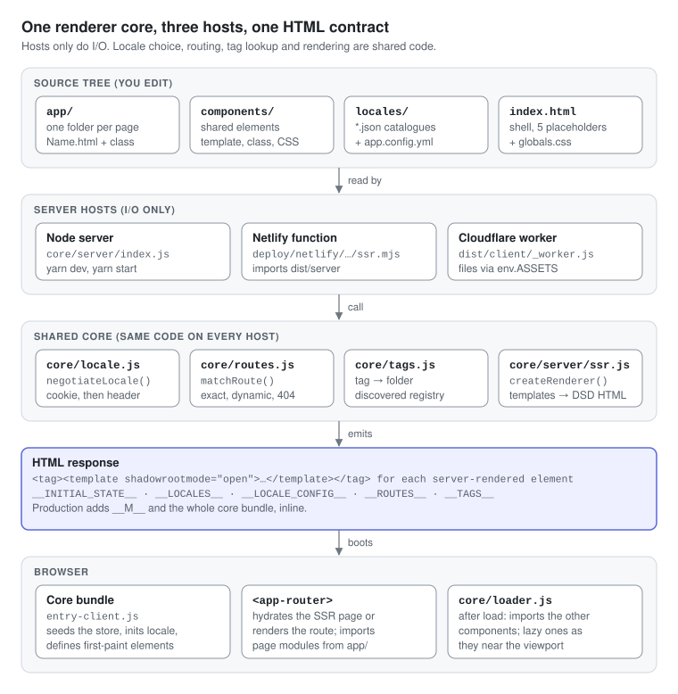
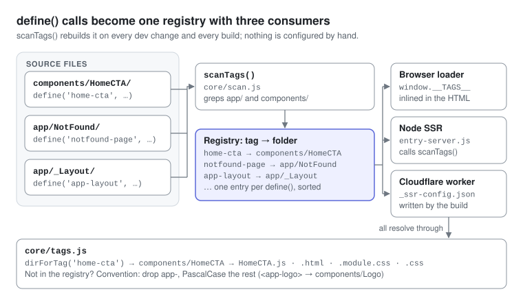
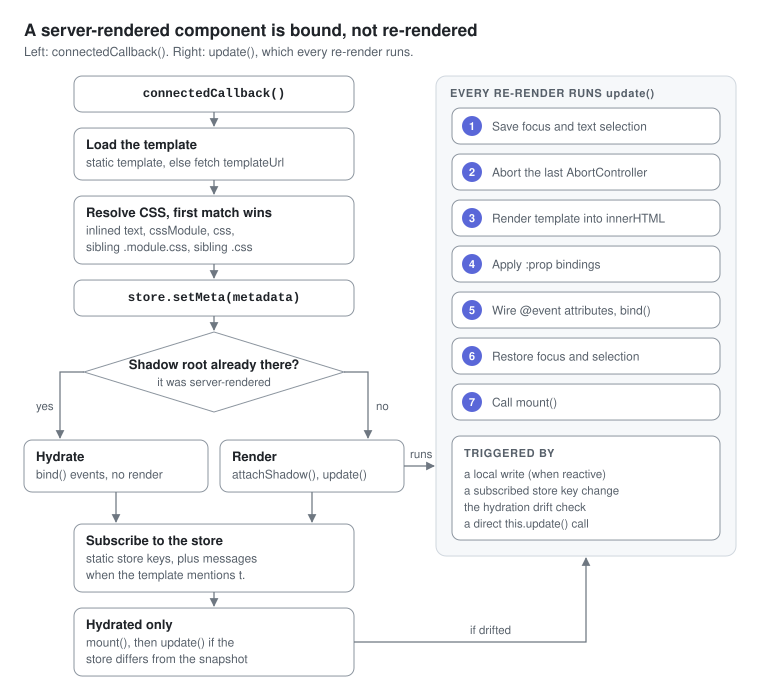
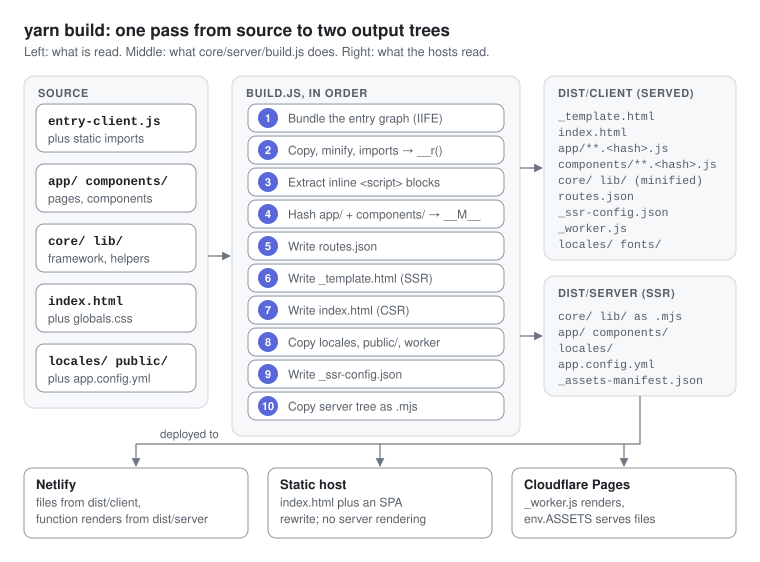
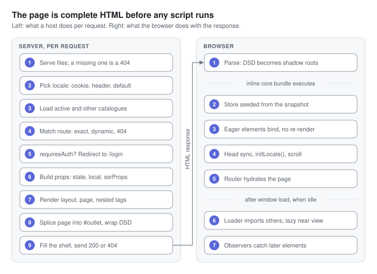

# Takeover

A zero-dependency web component framework with SSR, live reload, bundling, and i18n — built entirely on Node.js built-ins and native browser APIs.

No Vite. No Webpack. No React. No npm dependencies at all.



---

## Documentation

This README is the overview. The [developer guide in `docs/`](docs/README.md) is the deep dive: twelve chapters and five diagrams, each checked against the code and a running build.

| Chapter | Read it for |
| --- | --- |
| [1. Architecture](docs/01-architecture.md) | The parts, what runs where, and why the server never imports your classes |
| [2. Getting started](docs/02-getting-started.md) | Commands, environment variables, and how the dev loop really behaves |
| [3. Project layout](docs/03-project-layout.md) | Every folder, what to edit, and the naming rules the code relies on |
| [4. Request and boot lifecycle](docs/04-lifecycle.md) | The server's nine steps per request and the browser's seven |
| [5. Components](docs/05-components.md) | Statics, hooks, helpers, tag discovery, and how a component's JS arrives |
| [6. Templates and styling](docs/06-templates-and-styling.md) | `{{ }}` syntax and its limits, events, prop bindings, CSS Modules |
| [7. State and i18n](docs/07-state-and-i18n.md) | The store, local state, and how a language is chosen and switched |
| [8. Routing and navigation](docs/08-routing-and-navigation.md) | Folder-to-route rules, the Router element, navigation API, guards |
| [9. Build and deployment](docs/09-build-and-deploy.md) | The ten build steps, the output trees, bundler, minifier, hosts |
| [10. Recipes](docs/10-recipes.md) | Step-by-step changes: pages, components, routes, auth, locales, deploys |
| [11. Gotchas](docs/11-gotchas.md) | Verified pitfalls with causes and fixes |
| [12. Reference](docs/12-reference.md) | Config keys, window globals, exports, dev endpoints, numbers |

---

## What it is

Takeover is a full-stack web application framework built around the [Web Components](https://developer.mozilla.org/en-US/docs/Web/API/Web_components) standard (Custom Elements + Shadow DOM). It handles the full lifecycle:

- **Dev server** — server-rendered pages straight from source, native ESM, a file watcher and WebSocket live reload
- **SSR** — Declarative Shadow DOM, so pages paint before any JavaScript runs and hydration only binds events (plus a static CSR-only build target — see [Deployment](#deployment))
- **Bundler** — traces static `import` graphs into one IIFE that is inlined into the HTML
- **Minifier** — token-aware JS minifier + CSS minifier, both pure Node.js
- **i18n** — SSR-first locale negotiation and instant client-side switching (EN / ES / FR included)
- **Routing** — file-system routing from the `app/` directory, a client Router with guards and hooks
- **State** — reactive `EventTarget`-based store with per-key subscriptions
- **Edge adapters** — a Cloudflare Pages worker and a Netlify function that share one renderer with the Node server

It runs on Node 18+ (use Node 20+ on Linux, where the dev watcher needs recursive `fs.watch`). There are no packages to install.

Five ideas explain almost every design choice:

1. **Pages and components are custom elements.** Markup lives in `Name/Name.html`, behaviour in a class extending `Component`, registered with `define('tag-name', Class)`.
2. **The server emits Declarative Shadow DOM.** Each element is rendered as `<tag><template shadowrootmode="open">…</template></tag>`, so the browser builds shadow roots while it parses.
3. **The server never runs your classes.** It renders `.html` templates and reads page statics (`metadata`, `local`, `ssrProps`, `requiresAuth`) out of the source text, so component modules may use browser APIs at the top level.
4. **Re-rendering is wholesale.** A state change re-runs the template into `shadowRoot.innerHTML`. There is no virtual DOM; focus and text selection are restored around the swap.
5. **Conventions are discovered, not configured.** Routes come from `app/`, the tag-to-folder map from `define()` calls, locales from `locales/*.json`.

---

## Quick start

```bash
yarn dev            # http://localhost:3000 — SSR from source + live reload
yarn build          # production build into dist/client and dist/server
yarn preview:csr    # serve dist/client as a static SPA on http://localhost:4399
yarn clean          # remove dist/
```

| Command | Runs | Notes |
| --- | --- | --- |
| `yarn dev` | `node core/server/index.js` | Set `PORT` to change the port |
| `yarn build` | `node core/server/build.js` | 0.1–0.3 s on this repo |
| `yarn preview`, `yarn start` | `NODE_ENV=production node core/server/index.js` | SSR from the build in `dist/` — run `yarn build` first |
| `yarn test` | `node --test` | Unit tests in `test/` |
| `yarn preview:csr` | `node core/server/static.js` | Static server with an SPA fallback over `dist/client` (`PORT`, `CSR_ROOT` override) |
| `yarn deploy:cloudflare` | `yarn build && wrangler pages deploy` | Run `wrangler login` first |

Yarn is only a script runner here; `npm run dev` or the raw `node` commands work the same. Restart `yarn dev` after editing `app.config.yml` (read once per process); everything else is picked up live (see [Dev server and live reload](#dev-server-and-live-reload)).

→ More: [Getting started](docs/02-getting-started.md)

---

## Directory structure

```
takeover/
├── app/                    # Pages (file-system routed)
│   ├── _Layout/            # Root layout (<app-layout>; _ = not a route)
│   ├── Home/               # → /
│   └── NotFound/           # → /notfound (also the wildcard 404)
├── components/             # Shared components
│   ├── Router/             # <app-router> — client-side navigation + outlet
│   ├── Navigation/ Logo/ Footer/
│   ├── HeroCounter/ TriangleSeam/
│   └── HomeQuickStart/ HomeDemos/ HomePerformance/ HomeFeatures/
│       HomeStructure/ HomeArchitecture/ HomeInternals/ HomeCTA/
├── core/
│   ├── component.js        # Base Component class
│   ├── config.js           # app.config.yml loader (zero-dep YAML + autodiscovery)
│   ├── context.js          # Store (EventTarget Proxy)
│   ├── loader.js           # Auto-loader (MutationObserver + IntersectionObserver)
│   ├── locale.js           # Shared locale negotiation (cookie + Accept-Language)
│   ├── routes.js           # Route matching + path helpers + 404 fallback
│   ├── scan.js             # Directory scanner: routes + tag registry
│   ├── tags.js             # Tag → source directory resolution
│   ├── template.js         # Template engine (expressions, each, if)
│   └── server/
│       ├── index.js        # Dev/prod HTTP server + live reload
│       ├── build.js        # Production build pipeline
│       ├── bundle.js       # Zero-dep ESM bundler
│       ├── minify.js       # Zero-dep JS + CSS minifier
│       ├── static.js       # Zero-dep static server (CSR preview, SPA catch-all)
│       ├── entry-client.js # Browser entry point (lists the eagerly loaded components)
│       ├── entry-server.js # Node SSR entry point
│       ├── ssr.js          # Shared, platform-agnostic rendering logic
│       └── ws.js           # WebSocket server (no ws package)
├── lib/
│   ├── async.js            # Async helpers
│   ├── i18n.js             # Locale loading + t() helper
│   ├── index.js            # Public API barrel
│   ├── meta.js             # Head metadata utilities
│   ├── nav.js              # Navigation helpers (navigate, replace, getQuery…)
│   ├── store.js            # App-level store instance
│   └── validate.js         # Validation helpers
├── locales/                # en.json, es.json, fr.json
├── deploy/
│   ├── cloudflare/_worker.js       # Cloudflare Pages Worker (SSR)
│   └── netlify/functions/ssr.mjs   # Netlify Function (SSR)
├── docs/                   # Developer guide (12 chapters) + images/*.svg diagrams
├── public/                 # Served from the site root (/fonts, /logo.svg, robots.txt)
├── app.config.yml          # Per-project config (locales, preloads)
├── globals.css             # Design tokens, @font-face, reset (inlined into every page)
└── index.html              # Shell HTML (comment placeholders for SSR)
```

`core/` is the framework; everything an individual site tunes lives outside it — `app/`, `components/`, `lib/`, `locales/`, `globals.css`, and `app.config.yml`. The two places where `core/` still names project specifics are the eager-import list in `core/server/entry-client.js` and the store's `es` default locale in `lib/store.js`.

→ More: [Project layout](docs/03-project-layout.md)

---

## Configuration

Project-specific settings live in **`app.config.yml`** at the repo root. Core reads
it through `core/config.js` (a minimal zero-dependency YAML parser). Every key is
optional — omit one and the loader autodiscovers a sensible default. Delete the file
entirely and the framework still runs with discovered locales and no preloads.

```yaml
locales:
  # Supported locale codes. Omit, or set `auto`, to discover from locales/*.json.
  supported: [en, es, fr]
  # Locale used when a request matches none of the above.
  default: es

preload:
  # Same-origin woff2 fetched in parallel with HTML parse (@font-face in globals.css).
  # Omit → no font preloads. Use `auto` to preload every woff2 under public/fonts/.
  fonts:
    - /fonts/geist-latin.woff2
    - /fonts/geist-mono-latin.woff2
  # Extra dev-server modulepreloads (production inlines the core bundle, so these
  # only matter for `yarn dev`). Core's own /core/* modules are always included.
  modules:
    - /components/Router/Router.js
    - /lib/store.js
    - /lib/nav.js
```

| Key | Default when omitted |
|---|---|
| `locales.supported` | discovered from `locales/*.json` |
| `locales.default` | first supported locale |
| `preload.fonts` | none (empty) — or every `public/fonts/*.woff2` if set to `auto` |
| `preload.modules` | none (core `/core/*` modules are always preloaded) |

Font/module preloads are a curated performance decision (preloading *every* font
hurts LCP), so they default to empty — list only what genuinely blocks first paint.

The build copies `app.config.yml` into `dist/` so production SSR (and the Cloudflare /
Netlify adapters) negotiate locales from the same source. The supported/default
locales are also inlined as `window.__LOCALE_CONFIG__` so the client i18n layer
matches the server without hardcoding the list. The file is read once per process, so
restart `yarn dev` after editing it.

Three more optional keys: `site.url` (the public origin — the build then writes
`sitemap.xml` from the route table), `site.title` / `site.description` (the `<title>` and
meta description for pages without `static metadata`), and `auth.cookie` (the name of your
session cookie — a request that carries it gets `requiresAuth` pages server-rendered
instead of a redirect to `/login`).

→ More: [Reference](docs/12-reference.md#appconfigyml)

---

## Pages and routing

Pages live in `app/`. The directory name maps directly to the route:

| Directory | Route | Page tag |
|---|---|---|
| `app/Home/` | `/` | `home-page` |
| `app/NotFound/` | `/notfound` + wildcard 404 | `notfound-page` |
| `app/About/` | `/about` | `about-page` |
| `app/Users/[id]/User/` | `/users/:id/user` | `user-page` |

(The first two ship with this repo; the last two show the naming rules.) Folders and
files starting with `_` are skipped, which is what keeps `_Layout` out of the route table.
Three more rules the code relies on:

- **The file stem matches its folder**: `app/About/About.html`, never `index.html`.
- **The page tag is the lowercased stem plus `-page`**, with no hyphenation: `app/AboutUs/AboutUs.html` must call `define('aboutus-page', …)`.
- **A route can't end in a parameter**: `app/Items/[slug]/[slug].html` becomes `/items/:slug/:slug`. Keep a static last segment, as in `/users/:id/user`.

Each page is a folder with two files:

```
app/About/
  About.html   ← template (Shadow DOM content + optional <script> block)
  About.js     ← component class (optional if script is embedded in .html)
```

The script can live inside a `<script>` tag at the bottom of the `.html` file (extracted at build time) or in a separate `.js` file alongside it.

### Example page

```html
<!-- app/About/About.html -->
<style>
  :host { display: block; }
  h1 { color: var(--accent); }
</style>

<h1>About</h1>
<p>{{description}}</p>

<script>
import { Component, define } from '/core/component.js';

export default class AboutPage extends Component {
  static templateUrl = '/app/About/About.html';
  static metadata = { title: 'About', description: 'Who we are.' };
  static local = { description: 'We build things.' };     // seen by SSR and by the client
}

define('about-page', AboutPage);
</script>
```

Page statics must be **literal object expressions**: the server never imports the class,
it finds them in the source with a regex and `eval`s them. `static local` is the page's
initial state; `static ssrProps` is fixed data for its template — both render the same on
the server and on the client (the Router hands `ssrProps` to the page as `pageProps`).

→ More: [Routing and navigation](docs/08-routing-and-navigation.md)

---

## Components

Shared components live in `components/`. They follow the same two-file pattern as pages
and need no registration: `core/loader.js` imports a component's module when its tag
appears — after `load` (plus an idle callback) for server-rendered markup, and right away
for elements added later (it watches with a `MutationObserver` and a patched `attachShadow`).

| Strategy | Opt in by | The JS loads |
|---|---|---|
| Eager | an `import` in `core/server/entry-client.js` | with the inline core bundle |
| Automatic | just using the tag | after `load` + idle, or at once if added later |
| Lazy | `loading="lazy"` on the element | within 200px of the viewport |

```html
<app-footer loading="lazy"></app-footer>
```

Server-rendered content stays visible throughout; only the JS upgrade waits. Without
server-rendered content (client-side render, or a parent re-render) there's nothing to show
in the meantime, so a lazy import runs right away. A custom element may have children
(`<x-card><p>…</p></x-card>`): SSR adds the shadow root and leaves them as slotted light DOM.

### Tag → file mapping

Resolution is **discovered, not configured**. At dev-server start and at build time,
`core/scan.js` walks `app/` and `components/` for `define('<tag>', …)` calls and maps each
tag to the file that declares it. The result is inlined as `window.__TAGS__` for the
browser loader, passed directly to the Node SSR renderer, and written to
`_ssr-config.json` for the edge adapters — one registry, three consumers, no hand-kept
override table anywhere.



Because the folder is read off the `define()` call, names that don't round-trip through
kebab↔PascalCase — acronyms (`HomeCTA`), compound words (`HomeQuickStart`), internal
capitals (`NotFound`) — need no special handling. If a tag is missing from the registry
(defined at runtime, say), resolution falls back to the convention: `<foo-bar>` →
`components/FooBar/FooBar.js`, `<foo-page>` → `app/Foo/Foo.js`.

### Component API

```js
import { Component, define } from '/core/component.js';

export default class MyWidget extends Component {
  // URL of the HTML template (Shadow DOM content); the build inlines it
  static templateUrl = '/components/MyWidget/MyWidget.html';

  // CSS Module — class names are scoped to this element's tag.
  // Optional: a sibling MyWidget.module.css is picked up automatically.
  static cssModule = '/components/MyWidget/MyWidget.module.css';

  // Store keys to subscribe to — re-renders on change
  static store = ['user'];

  // Initial local (per-instance) state — cloned for each instance
  static local = { count: 0, open: false };

  // After every render and on hydration: register listeners here
  bind() {
    this.on('#btn', 'click', () => this.local.count++);
    this.on('form', 'submit', e => this.handleSubmit(e));
    this.delegate('click', '.item', (el, e) => console.log(el));
  }

  // After EVERY update(), and once after hydration — not a one-time hook
  mount() {}

  // Called when element disconnects
  unmount() {}

  handleSubmit(e) {
    e.preventDefault();
    const data = this.getFormData();
    this.withLoading(() => submitData(data));
  }
}

define('my-widget', MyWidget);
```



#### Helpers

| Method | Description |
|---|---|
| `this.$(sel)` | `shadowRoot.querySelector` |
| `this.$$(sel)` | `shadowRoot.querySelectorAll` → Array |
| `this.on(target, event, fn)` | Adds an event listener, removed before the next render and on disconnect |
| `this.emit(name, detail)` | Dispatches a bubbling, composed CustomEvent |
| `this.delegate(evt, sel, fn)` | Event delegation on the shadow root |
| `this.signal` | The current render's `AbortSignal`, for your own fetches and listeners |
| `this.cx(...args)` | CSS class helper: strings, objects, arrays → scoped class string |
| `this.batch(fn)` | Run multiple `local` mutations with a single re-render |
| `this.withLoading(fn, key?)` | Sets `local[key]` true while async fn runs |
| `this.bindForm(fields)` | Bind `<input>` elements to `local` state keys |
| `this.getFormData(sel?)` | Read form as plain object via `FormData` |
| `this.resetForm(sel?)` | Reset a form |
| `this.update()` | Re-render now |

Register listeners through `this.on()` / `this.delegate()` rather than raw
`addEventListener` in `mount()`: `mount()` runs after every render, so raw listeners pile up.

→ More: [Components](docs/05-components.md)

---

## Styling

Two options, usable together:

**Inline `<style>` in the template.** Simplest, and what most components here do. The block
is hoisted into the shadow root, so selectors are already isolated — no scoping needed.

**A CSS Module file.** Put `MyWidget.module.css` next to `MyWidget.html` and it is
discovered automatically (no declaration required). Class names get the element's tag
appended — `.inner` → `.inner_app-footer` — so templates reference them through `$css`
and JavaScript through `this.cx()`:

```html
<div class="{{$css.inner}}">…</div>
```

```js
bind() { this.$('.x')?.classList.add(this.cx('active')); }  // cx() maps names too
```

`components/Footer/` is a worked example. A plain `MyWidget.css` (no `.module`) is also
picked up and used **unscoped**, and can coexist with a module sheet.

Element, `:host` and pseudo selectors are left alone by the scoping pass — the shadow
boundary already isolates those. The pass is a regex over the whole file, so it also
rewrites dotted words in comments and in URLs (`url(hero.png)` → `url(hero.png_<tag>)`):
keep module comments prose-only and images out of module sheets.

Design tokens (`--bg`, `--fg`, `--accent`, …) and `@font-face` live in `globals.css`, which
is inlined into every page; custom properties cross shadow boundaries, ordinary selectors don't.

In production the build folds the stylesheet's source into the component class, so a CSS
Module costs no extra request at runtime; SSR embeds the same scoped CSS in the shadow root.

→ More: [Templates and styling](docs/06-templates-and-styling.md#styling)

---

## Template engine

Templates use `{{ }}` expressions evaluated against `props` (store state + local state + page props + `t` for translations):

```html
<!-- Interpolation (HTML-escaped) -->
<p>{{user.name}}</p>

<!-- Unescaped -->
<p>{{{rawHtml}}}</p>

<!-- Conditionals -->
{{#if isAuthenticated}}
  <span>{{user.username}}</span>
{{else}}
  <a href="/login" route>Login</a>
{{/if}}

<!-- Loops: a top-level array; item fields are HTML-escaped -->
{{#each items}}
  <li>{{this.name}} — {{@index}}</li>
{{/each}}

<!-- Ternary -->
<span>{{theme === 'dark' ? '☀️' : '🌙'}}</span>

<!-- CSS Modules -->
<div class="{{$css.card}}">

<!-- Translation -->
<span>{{t.nav.docs}}</span>

<!-- Events: calls this.save(event); "store.logout" would call store.logout() -->
<button @click="save">Save</button>
```

Expressions are parsed with JavaScript's precedence (`?:`, `||`, `&&`, comparisons,
arithmetic, `!`, parentheses) but are not JavaScript: only a safelist of string/array
methods can be called. An expression that evaluates to `undefined` stays on the page as
literal `{{expr}}` (`null` prints `null`), and `{{#each}}` can't nest or take a dotted
path. Compute anything non-trivial in JS and expose the result as a prop.

Prop bindings (experimental) pass JavaScript values (not strings) to child custom elements:

```html
<my-widget :count="localCount" :user="user"></my-widget>
```

On the client this sets `child.count` as a property after every parent render (the child's
template sees it only if the child copies it into `local`); on the server the value is
merged into the child's template props.

→ More: [Templates and styling](docs/06-templates-and-styling.md)

---

## State management

The store is a `Proxy`-wrapped `EventTarget`. Changes fire `change` and `change:<key>` events.

```js
import store from '/lib/store.js';

// Read
store.get()           // full state snapshot
store.get('user')     // single key

// Write
store.set({ counter: 5, user: { name: 'Alice' } });
store.update('counter', n => n + 1);
store.toggle('sidebarOpen');
store.reset('counter');   // back to default
store.reset();            // all keys to defaults

// Subscribe (returns unsubscribe fn)
const unsub = store.on('counter', (value, oldValue) => {
  console.log('counter changed', value);
});
unsub();

// Merge into the page metadata key (the only action lib/store.js adds)
store.setMeta({ title: 'My Page' });
```

The store ships deliberately bare: `lib/store.js` defines the defaults
(`{ meta, locale, messages }`) and `setMeta`. Application actions — auth, theme, anything
domain-specific — belong in your own module on top of it, not in the framework.

Components subscribe declaratively via `static store = ['key1', 'key2']` and re-render automatically when any subscribed key changes. Two details decide whether they do:

- `store.set()` compares by reference: setting the same (mutated) object fires nothing, so set a new one — `store.set({ user: { ...user, name } })`.
- A nested write such as `store.state.user.name = 'x'` fires `change:user.name`, not `change:user`, so a component subscribed to `user` won't re-render.

→ More: [State and i18n](docs/07-state-and-i18n.md)

---

## i18n

Three locales are included: **English**, **Spanish**, **French**.

### In templates

`t` is the messages object for the current locale, injected into every component's props automatically. Templates that mention `t.` re-render when the locale changes:

```html
<a href="#quickstart">{{t.nav.quickstart}}</a>
<button>{{t.hero.cta}}</button>
```

### In JavaScript

```js
import { t, setLocale, getLocale, initLocale } from '/lib/i18n.js';

t('nav.docs')                     // → 'Docs'
t('cart.items', { n: 3 })         // '{n} items' → '3 items', if your catalogue defines it
setLocale('es');                  // async — loads the catalogue, updates the store, sets a cookie
getLocale();                      // → 'es'
```

`t()` returns the key itself when a message is missing; templates have no `{var}` interpolation.

### Adding a locale

1. Create `locales/de.json` following the same shape as `en.json` (a missing key renders as raw `{{t.…}}`)
2. Add `de` to `locales.supported` in `app.config.yml` (or rely on autodiscovery —
   omit the key / set `supported: auto` and the new file is picked up automatically)
3. Add a switch control in `components/Navigation/Navigation.html` + `.js` (the language
   buttons there call `setLocale('en' | 'es' | 'fr')`)
4. Restart `yarn dev` if you edited `app.config.yml`

The supported list and default locale are defined once in `app.config.yml`; the
server, the deploy adapters, and the client i18n layer all read from it (no
hardcoded locale array in `lib/i18n.js`).

### SSR locale detection

`core/locale.js` implements negotiation once and every SSR host uses it — the dev/prod
server, the Netlify function and the Cloudflare worker — so all three resolve the same
language for the same request. The `locale` cookie (an explicit user choice) wins over
`Accept-Language`, which is ranked by q-value; anything unsupported falls back to
`locales.default`.

The negotiated locale pre-renders the page, and three globals are inlined so the client
never flashes: `__INITIAL_STATE__` (active locale + its messages), `__LOCALES__` (the other
supported catalogues, so a switch needs no fetch) and `__LOCALE_CONFIG__` (the supported
list, so client negotiation matches the server's). The Netlify and Cloudflare adapters send
`Vary: Accept-Language, Cookie`; the Node server does not.

→ More: [State and i18n](docs/07-state-and-i18n.md#how-a-language-is-chosen)

---

## Production build

```bash
yarn build
```



Output in `dist/client/`:

```
dist/client/
├── _assets/
│   └── core.[hash].js       # Bundled framework (also inlined into the HTML)
├── _template.html           # SSR HTML shell (per-request placeholders left empty)
├── index.html               # CSR shell (placeholders pre-filled at build time)
├── _assets-manifest.json    # original URL → content-hashed URL (inlined as __M__)
├── _ssr-config.json         # locales + tag registry, for edge adapters
├── _manifest.json           # Build manifest (debugging)
├── _worker.js               # Cloudflare Pages Worker
├── app/                     # Minified, content-hashed page modules
├── components/              # Minified, content-hashed component modules
├── core/                    # Minified framework files
├── lib/                     # Minified utilities
├── locales/                 # Locale JSON files
└── routes.json
```

`dist/server/` holds the `.mjs` copy of `core/`, `lib/`, `app/` and `components/` that the Netlify function renders from.

The **bundler** (`core/server/bundle.js`) traces all static `import` chains from `entry-client.js` and emits a single IIFE with a minimal module registry — here 17 modules, 59.9 kB minified, about 17 kB gzipped. Dynamic `import()` calls (used by the router for route-level code splitting) are left intact with resolved paths.

The **minifier** (`core/server/minify.js`) uses a character-level tokenizer that correctly handles template literals, strings, regex literals, and comments. It cuts the core bundle by 38% without identifier mangling.

Templates and stylesheets are **inlined into their component class** at build time
(`static template`, `static cssModuleText` / `static cssText`), so a component costs no
template or CSS request once its module has loaded.

Assets get content-addressed filenames (`core.d6d6fad4.js`) for long-lived caching. Lazy
page/component modules are hashed too, and the original → hashed map is inlined as
`window.__M__`, which is what makes `max-age=31536000, immutable` safe for `/app/*` and
`/components/*`.

Lazy modules (everything in `app/` and `components/`) import as usual: a static import
of a bundled module is read from the registry, and one of anything else — such as
`/lib/validate.js` — becomes a fetch through `window.__M__`. Relative and root-absolute
specifiers both work, including in the inline `<script>` of a page.

→ More: [Build and deployment](docs/09-build-and-deploy.md)

---

## Dev server and live reload

The dev server watches `app/`, `components/`, `core/`, `lib/`, `locales/`, `globals.css`
and `index.html` with `fs.watch` (50ms debounce) and messages connected browsers over a
hand-rolled WebSocket:

| You change | What happens |
|---|---|
| `globals.css` | The inlined stylesheet is swapped in place — no reload |
| Anything else that's watched | The page reloads, server-rendered from the new source (rendering runs in a worker thread that is replaced on every change, so `core/` and `lib/` edits count too) |

Custom elements can't be redefined, so there is no per-component hot swap. New pages and
components need no restart; the route and tag tables are rebuilt on every change.

→ More: [Getting started → The dev loop](docs/02-getting-started.md#the-dev-loop)

---

## Navigation

Use the `route` attribute on `<a>` tags for client-side navigation (the Router intercepts clicks, including inside shadow roots):

```html
<a href="/about" route>About</a>
```

From JavaScript:

```js
import { navigate, replace, back, getQuery, setQuery } from '/lib/nav.js';

navigate('/dashboard');
replace('/login?from=/dashboard');
back();
getQuery();                          // → { from: '/dashboard' }
setQuery({ tab: 'profile' });
```

Route lifecycle hooks on the Router — set them in a module that loads before the first navigation, such as `app/_Layout/_Layout.js`:

```js
import Router from '/components/Router/Router.js';

Router.beforeEach = async (to, from) => {
  if (needsAuth(to.path) && !isLoggedIn()) return '/login';
};

Router.afterEach = (to, from) => analytics.track(to.path);
Router.onError = (err, to) => console.error(err);
```

In-page `#anchor` links work across shadow roots too: the Router resolves the target with `scrollToHash()` from `lib/nav.js`.

→ More: [Routing and navigation](docs/08-routing-and-navigation.md)

---

## Deployment

### Cloudflare Pages

```bash
yarn deploy:cloudflare   # runs build then wrangler pages deploy
```

The Cloudflare Worker (`deploy/cloudflare/_worker.js`) handles SSR at the edge and delegates
static assets to the Pages asset store. It has no `node:fs`, so it can't read
`app.config.yml` or walk the source tree — the build emits `_ssr-config.json` (supported
locales + tag registry) for it, and negotiation itself is the shared `core/locale.js`. Net
effect: the edge renders the same locale, the same components and the same 404 fallback as
the Node server — with a real 404 status. Any path with an extension other than `.html` is
answered from the asset store, so a missing file is a 404 rather than the app.

The build emits no `_headers` file and `netlify.toml`'s cache rules don't apply here, so add
`public/_headers` if you want immutable caching for the hashed files on Cloudflare.

### Netlify

Configure via `netlify.toml`. Static assets are served directly; all other requests hit the
SSR Netlify Function in `deploy/netlify/functions/ssr.mjs`, which runs against `dist/server`
(the `.mjs` copy of the tree). A file-like path that reaches it (a missing `/llms.txt` or
`/.well-known/ard.json`) gets a plain 404, and unmatched routes render NotFound with a 404
status: answering 200 would make crawlers and agents treat the app's HTML as that file.

Netlify serves an existing file before applying a non-forced rewrite, and the build writes
the CSR shell to `dist/client/index.html`, so check that `/` on your deployment is
server-rendered (its HTML contains `shadowrootmode`).

### Static / CSR-only hosting

SSR is the default, but the same `yarn build` also emits a **client-rendered shell** at
`dist/client/index.html` for hosts with no SSR runtime (GitHub Pages, S3, a CDN bucket).
It's the SSR template with the per-request placeholders pre-filled: empty `app-layout`,
the default locale's state, every other catalogue, and `window.__LOCALE_CONFIG__`, so the
first client render already has its messages. On load the Router finds an empty outlet and
renders the route in the browser — the identical code path SSR pages take after hydration
(`core/component.js` falls back to `attachShadow()` + `update()` when no Declarative
Shadow DOM is present).

Build and preview it locally with two commands:

```bash
yarn build         # emits dist/client/index.html (the CSR shell) alongside the SSR template
yarn preview:csr   # zero-dep static server → http://localhost:4399 (PORT/CSR_ROOT override)
```

`yarn preview:csr` (`core/server/static.js`) serves `dist/client/` with a **SPA catch-all** —
any extension-less path that isn't a real file falls back to `/index.html`, so deep links
like `/about` resolve and the Router renders them client-side. On a real host you express
the same rule as a rewrite: Netlify `/* /index.html 200`, Cloudflare Pages `_redirects`,
nginx `try_files $uri /index.html`. The SSR adapters keep using `_template.html` and are
unaffected — CSR is purely additive.

What you trade away vs. SSR: no prerendered HTML (blank first paint until the bundle
runs), no server locale negotiation, and crawlers without JS see an empty shell. Use it
where an SSR runtime isn't available; prefer SSR everywhere else.

### Node (`yarn start`)

`NODE_ENV=production node core/server/index.js` server-renders from the build: static
files come from `dist/client` (hashed modules and fonts cached as `immutable`, everything
else revalidated), pages are rendered with `dist/server`. Run `yarn build` first — with no
build it warns and serves the source tree instead. It does no compression or TLS, so put a
reverse proxy in front of it.

→ More: [Build and deployment](docs/09-build-and-deploy.md#deployment-targets)

---

## Known issues

[Gotchas](docs/11-gotchas.md) lists every verified pitfall with its cause and fix. The ones most likely to bite:

- **An expression that evaluates to `undefined` prints as literal `{{expr}}`** — by design, so a missing key is visible; give optional values a default (`{{name || ''}}`).
- **Listeners added with raw `addEventListener` in `mount()` stack up** — it runs after every render; use `this.on()` / `this.delegate()`.

---

## Architecture notes



- **No virtual DOM.** Components re-render their shadow root's `innerHTML` directly. Focus state is preserved across re-renders by tracking `activeElement` before and restoring it after.
- **No hydration mismatch.** SSR uses [Declarative Shadow DOM](https://developer.chrome.com/docs/css-ui/declarative-shadow-dom) (`<template shadowrootmode="open">`). The browser attaches shadow roots before JS runs, so hydration is just event binding — the DOM is never replaced.
- **No build tool dependencies.** The bundler, minifier, WebSocket server, file watcher, and HTTP server are all implemented against Node.js built-ins (`node:fs`, `node:http`, `node:crypto`, `node:path`).
- **CSS Modules without PostCSS.** Class names are scoped by appending the element's tag name as a suffix (`.card` → `.card_my-widget`) via a regex pass at load time. The same transform runs server-side for SSR.
- **One implementation per cross-cutting concern.** Tag→directory resolution (`core/tags.js`,
  fed by a discovered registry), locale negotiation (`core/locale.js`) and the 404 fallback
  route (`withNotFound` in `core/routes.js`) are each written once and shared by the browser,
  the Node server and every deploy adapter. Anything duplicated per host drifts.
- **Core stays (almost) project-agnostic.** Component names, locale codes and route paths
  are discovered from the source tree or read from `app.config.yml`; the exceptions are the
  eager-import list in `core/server/entry-client.js` and the store's default locale in
  `lib/store.js`.

→ More: [Architecture](docs/01-architecture.md) and [Request and boot lifecycle](docs/04-lifecycle.md)
