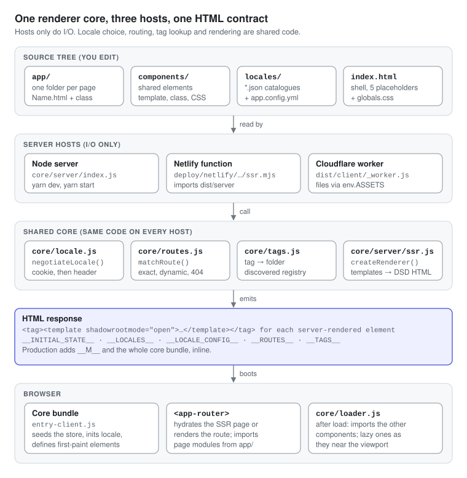

# Architecture

One renderer core is shared by three server hosts, and every host emits the same HTML contract: Declarative Shadow DOM markup plus inlined `window` globals that the browser bundle boots from.

1. **Sources** are yours: pages in `app/`, shared elements in `components/`, catalogues in `locales/`, settings in `app.config.yml`, and the shell in `index.html` plus `globals.css`.
2. **Hosts** only do I/O: the Node server (`core/server/index.js`, used by `yarn dev` and `yarn start`), the Netlify function (`deploy/netlify/functions/ssr.mjs`) and the Cloudflare Pages worker (`deploy/cloudflare/_worker.js`). Each reads files, negotiates a locale and fills the shell.
3. **Shared core** does the work: `core/locale.js` picks the language, `core/routes.js` matches the URL with a NotFound fallback, `core/tags.js` maps tags to folders, and `core/server/ssr.js` renders templates through `core/template.js`.
4. **HTML** carries DSD markup for every server-renderable element, plus `__INITIAL_STATE__`, `__LOCALES__`, `__LOCALE_CONFIG__`, `__ROUTES__`, `__TAGS__`, and in production `__M__` and the inline core bundle.
5. **Browser**: the core bundle (built from `core/server/entry-client.js`) seeds the store, defines the above-the-fold elements and starts `<app-router>` and the loader. The Router imports page modules; the loader imports every other component on demand.

## What runs where

| Concern | Server | Browser |
| --- | --- | --- |
| Route table | Scanned from `app/` (dev: every request; production: once per process) | `window.__ROUTES__` |
| Tag-to-file registry | `scanComponents()` over `app/` and `components/` | `window.__TAGS__` |
| Templates | Read from disk, rendered to strings | Fetched from `templateUrl` (dev) or inlined as `static template` (production) |
| Component classes | Never imported | Imported and defined as custom elements |
| Page statics (`metadata`, `local`, `ssrProps`, `requiresAuth`) | Regex-extracted from source and `eval`'d | Read off the class; `ssrProps` arrives through the route table as `pageProps` |
| Locale | `negotiateLocale()` per request | `initLocale()` from the cookie or `navigator.language` |
| Store | One module instance per process, re-seeded per render | One instance, seeded from `__INITIAL_STATE__` |

Because the server never imports component classes, component modules may touch `window`, `HTMLElement` and `customElements` at the top level; `Component` itself extends `HTMLElement` only when `window` exists. The price is that page statics must be literal objects that SSR can read out of the source text.

---

[← Overview](README.md) · [Index](README.md#contents) · [Getting started →](02-getting-started.md)
