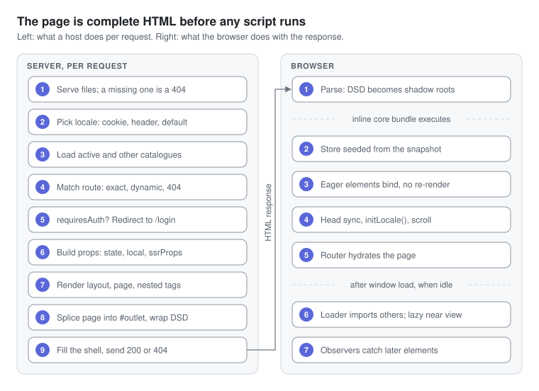

# Request and boot lifecycle

A page arrives as complete, styled HTML before any JavaScript runs; the browser then only defines elements and binds events, and imports everything below the fold after `load`.

## On the server, per request

1. **Files first.** A path with an extension other than `.html` is served from the repo root, then `public/`, else 404. Dev extras: `?script` returns a `.html` file's inline script, `?raw` wraps any file as `export default "…"`, a missing `.js` falls back to the sibling `.html`'s script, and a missing `.css` returns an empty 200.
2. **Negotiate the locale** with `negotiateLocale()`: a supported `locale` cookie wins, then `Accept-Language` by q-value, then `locales.default`.
3. **Load catalogues.** The active one goes into the store; the other supported ones are inlined as `__LOCALES__`.
4. **Match the route**: exact path, then dynamic patterns, then the `*` clone of NotFound (status 404).
5. **Guard.** A page with `requiresAuth` redirects (302) to `/login?from=<path>` unless `state.isAuthenticated`, which the server never sets.
6. **Build props**: store state, the page's `local` and `ssrProps`, plus `path`, `params`, `query`, `redirectFrom`, `timestamp`, `year` and `t`.
7. **Render** `<app-layout>`, then the page, then every nested custom element written empty, up to 50 passes deep. Each becomes `<tag><template shadowrootmode="open">…</template></tag>`.
8. **Splice** the page into `<app-router>
…
</app-router>` inside the layout.
9. **Fill the shell** (`index.html` in dev, `dist/client/_template.html` in production) and respond.

| Placeholder in `index.html` | Dev server fills it with | Production SSR | CSR shell `dist/client/index.html` |
| --- | --- | --- | --- |
| `<!--inline-css-->` | `globals.css` | minified `globals.css`, at build | same as SSR |
| `<!--preload-links-->` | font preloads, `/core/*` and `preload.modules` modulepreloads, `__TAGS__`, `__ROUTES__` | font preloads, `__M__`, `__TAGS__`, `__ROUTES__`, at build | same as SSR |
| `<!--head-meta-->` | page modulepreload, `<title>`, meta description | same, per request | home page's title and description, at build |
| `<!--app-html-->` | rendered DSD | rendered DSD, per request | empty |
| `<!--initial-state-->` | `__INITIAL_STATE__`, `__LOCALES__`, `__LOCALE_CONFIG__` | same, per request | default locale's state, at build |

The build also replaces `<script type="module" src="/core/server/entry-client.js">` with the whole core bundle inline. Hosts fill placeholders with function-form `replace()`, so `$` sequences inside the bundle survive.

## In the browser

1. **Parse.** DSD templates become shadow roots as the HTML streams in: the page is visible and styled with no JS. A head script sets `data-theme` before first paint.
2. **The core bundle runs.** `lib/store.js` seeds itself from `__INITIAL_STATE__` while the module evaluates, so the first `connectedCallback` already sees the final locale.
3. **Eager elements upgrade**: `app-layout`, `app-router`, `app-navigation`, `app-logo`, `hero-counter`, `triangle-seam`. Each finds its shadow root in place, so it binds events and calls `mount()` without re-rendering.
4. **Entry tail**: `store.set(__INITIAL_STATE__)`, a `meta` subscription that keeps `<title>` and meta tags in sync, `initLocale()`, and scroll restoration.
5. **The Router hydrates.** It finds the server-rendered page in `#outlet` and imports its module so the page element upgrades. With an empty outlet (the CSR shell) it renders the route itself.
6. **After `load` and an idle callback**, the loader walks the document and every shadow root, imports the remaining components, and hands `loading="lazy"` ones to an `IntersectionObserver` with a 200px margin.
7. **From then on**, a `MutationObserver` and a patched `attachShadow` catch every element added later.

A hydrated component re-renders only if a store key it depends on differs from the SSR snapshot, for example when the client switches locale.

---

[← Project layout](03-project-layout.md) · [Index](README.md#contents) · [Components →](05-components.md)
