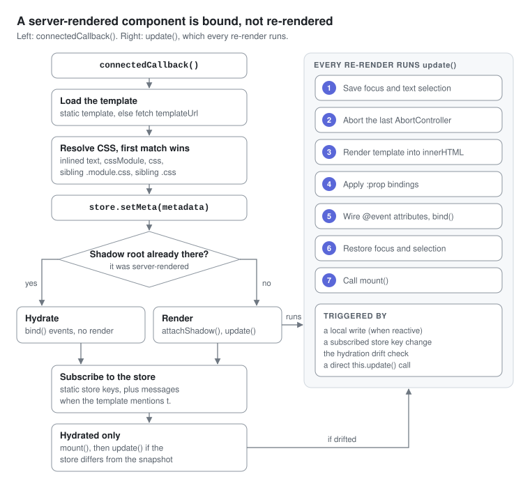
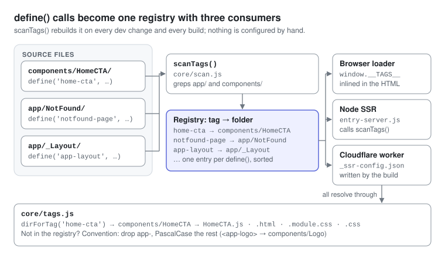

# Components

A component is a folder with a template and usually a class; the folder name, the file stems and the `define()` call are all the wiring there is.

```text
components/Greeting/
  Greeting.html         template: markup, optional <style>, may embed a <script>
  Greeting.js           class (optional when the .html has an inline <script>)
  Greeting.module.css   optional, scoped class names via $css
  Greeting.css          optional, unscoped
```

```js
// components/Greeting/Greeting.js
import { Component, define } from '../../core/component.js';

export default class Greeting extends Component {
  static templateUrl = '/components/Greeting/Greeting.html';
  static store = ['locale'];        // re-render when these store keys change
  static local = { open: false };   // per-instance state, deep-cloned

  bind() {                          // after every render, and on hydration
    this.on('#toggle', 'click', () => this.local.open = !this.local.open);
  }
}

define('app-greeting', Greeting);
```

```html
<!-- components/Greeting/Greeting.html -->
<style>:host { display: block; }</style>
<button id="toggle">{{t.nav.docs}}</button>
{{#if open}}<p>Locale: {{locale}}</p>{{/if}}
```

Use it as `<app-greeting></app-greeting>`, written empty so SSR can expand it. There is no registration step: the next request or build discovers the tag.

## Static fields

| Static | Type | Effect |
| --- | --- | --- |
| `templateUrl` | string | Template URL; the build replaces it with `static template` |
| `template` | string | Inline template; wins over `templateUrl` |
| `store` | string[] | Store keys whose change re-renders the component |
| `local` | object | Initial local state, deep-cloned per instance through JSON |
| `reactive` | boolean, default `true` | `false` stops `local` writes from re-rendering |
| `metadata` | `{ title, description }` | Merged into the store's `meta` on connect; for pages SSR also writes it into `<head>` |
| `requiresAuth` | boolean | Pages only: redirect to `/login?from=…` unless `isAuthenticated` |
| `ssrProps` | object | Pages only: fixed template data. Read from the source text by SSR and carried in the route table, so the Router passes the same values to the client as `pageProps` |
| `cssModule`, `css` | string | Explicit stylesheet URLs; default to the sibling `Name.module.css` and `Name.css` |
| `cssModuleText`, `cssText` | string | Filled in by the build; don't set them by hand |

## Lifecycle hooks

| Hook | Runs |
| --- | --- |
| `bind()` | After every render, once the new DOM is in place, and once on hydration. Register listeners here |
| `mount()` | After **every** `update()`, and once after hydration. It is not a one-time hook |
| `unmount()` | On disconnect, after listeners and store subscriptions are dropped |
| `onLocalChange(key, value)` | If defined, on each `local` write **instead of** the automatic re-render |



`connectedCallback` loads the template (inline or fetched), resolves CSS (inlined text, then `cssModule`, then `css`, then a sibling `.module.css`, then a sibling `.css`) and merges `metadata` into the store. With a server-rendered shadow root it only binds events; otherwise it attaches a shadow root and calls `update()`. It then subscribes to the `static store` keys, plus `messages` when the template mentions `t.`; a hydrated component finally calls `mount()` and re-renders only if one of those keys drifted from the SSR snapshot.

`update()` saves the focused element and its selection, aborts the previous render's `AbortController` (dropping every listener added through `this.on`), renders the template into `shadowRoot.innerHTML`, applies `:prop` bindings, wires `@event` attributes, calls `bind()`, restores focus and calls `mount()`.

Writes to `local` and changes to subscribed store keys do not call `update()` on the spot: they queue one render for the end of the current task, so `this.local.a = 1; this.local.b = 2` (or a locale switch, which changes both `locale` and `messages`) re-renders once. Call `update()` yourself when the DOM has to be current on the very next line.

## Instance helpers

| Member | Does |
| --- | --- |
| `this.$(sel)`, `this.$$(sel)` | `querySelector`, and `querySelectorAll` as an array, on the shadow root |
| `this.on(target, evt, fn, opts)` | `addEventListener` on a selector or node; removed on the next render and on disconnect |
| `this.delegate(evt, sel, fn)` | One shadow-root listener calling `fn(matchedEl, event)` for targets inside `sel` |
| `this.emit(name, detail)` | Dispatch a bubbling, composed `CustomEvent` |
| `this.signal` | The current render's `AbortSignal`, for your own `fetch` calls and listeners |
| `this.local` | Reactive local state; assignment re-renders unless `reactive = false` or inside `batch()` |
| `this.batch(fn)` | Run several `local` writes, render once |
| `this.withLoading(fn, key = 'isLoading')` | Set `local[key]` while the async `fn` runs |
| `this.bindForm({ key: '#sel' })` | Mirror inputs into `local` on `input` and `change` |
| `this.getFormData(sel)`, `this.resetForm(sel)` | Read a form as a plain object, reset it (default selector `form`) |
| `this.cx(...)` | Class names from strings, arrays and `{ name: bool }`, mapped through the CSS Module |
| `this.state` | Store snapshot, refreshed when a subscribed key changes |
| `this.props` | What the template sees (see [Templates and styling](06-templates-and-styling.md#what-a-template-can-see)) |
| `this.pageProps` | `{ ...ssrProps, path, params, query }`, set by the Router on pages — on client navigation and when it hydrates a server-rendered page |
| `this.update()` | Re-render now |

## Discovery



`scanComponents()` in `core/scan.js` greps `app/` and `components/` for `define('<tag>'` (including `_`-prefixed folders and `.html` and `.mjs` files) and records the declaring file without its extension (`components/HomeCTA/HomeCTA`), sorted so build hashes stay stable; it also collects each component's `static local` for SSR. The browser loader gets the registry as `window.__TAGS__`, the Node SSR entry calls `scanComponents()` directly, and the Cloudflare worker reads `dist/client/_ssr-config.json`. All three resolve file paths through `core/tags.js`. A tag missing from the registry falls back to convention: drop an `app-` prefix, PascalCase the rest, and look in `components/`, or in `app/` for `-page` tags.

## How a component's JavaScript arrives

| Strategy | Opt in by | Loads | Use for |
| --- | --- | --- | --- |
| Eager | An `import` in `core/server/entry-client.js` | With the inline core bundle | Above-the-fold, interactive parts |
| Automatic | Nothing: just use the tag | After `load` plus an idle callback (500 ms cap), or at once if added later | Everything else |
| Lazy | `loading="lazy"` on the element | Within 200px of the viewport; immediately if it has no SSR content | Below-the-fold sections |
| Page | A folder under `app/` | Imported by the Router | Routes |

Server-rendered content is visible in all four cases; only interactivity waits. Plain custom elements work too: `components/TriangleSeam` extends `HTMLElement`, has no template, renders in `connectedCallback`, and is never server-rendered.

---

[← Lifecycle](04-lifecycle.md) · [Index](README.md#contents) · [Templates and styling →](06-templates-and-styling.md)
