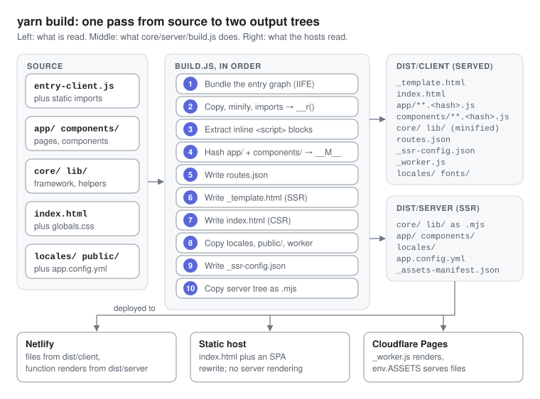

# Build and deployment

`yarn build` turns the source tree into `dist/client` (what browsers download) and `dist/server` (what SSR functions execute), with the core framework inlined into the HTML shell; on this repo it finishes in 0.1 to 0.3 s and produces a 62 KB core bundle.

## What `core/server/build.js` does, in order

1. **Bundle** `core/server/entry-client.js` and its static import graph (17 modules here) into one IIFE with a tiny registry: `__d` defines a module, `__r` requires one, and both are exposed on `globalThis`. Templates are inlined first. The result goes to `_assets/core.<hash>.js` and, inline, into the shell.
2. **Copy and minify** `app/`, `components/`, `lib/` and the runtime half of `core/` into `dist/client` (the Node-only files — the build, the servers, `config.js`, `scan.js` — are left out; `core/server/ssr.js` stays for the Cloudflare worker). In `app/` and `components/`, a static import of a bundled module becomes `globalThis.__r('<root-relative path>')`, so lazy modules reuse the bundled framework instead of fetching it again; an import of any other local module becomes a top-level `await import()` resolved through `window.__M__`. `static templateUrl` becomes `static template` (with its `<style>` blocks minified), and sibling stylesheets become `static cssModuleText` and `cssText`.
3. **Extract inline scripts** from `.html` files: pages emit `Name.script.js`, components emit `Name.js` unless one already exists. Their imports get the same rewrite, relative specifiers included.
4. **Content-hash** every `.js` under `app/` and `components/` (`Name.<8 hex of sha256>.js`) and write `_assets-manifest.json`, which is inlined as `window.__M__`.
5. **Write `routes.json`** with metadata, `ssrProps`, `requiresAuth` and hashed module URLs.
6. **Write `_template.html`**, the SSR shell: minified `globals.css`, font preloads, `__M__`, `__TAGS__`, `__ROUTES__` and the bundle inline, with the per-request placeholders left empty.
7. **Write `index.html`**, the CSR shell: the same, pre-filled with the home page's metadata, the default locale's state and every other catalogue.
8. **Copy** `locales/` to both sides, `public/` flattened into the client root, `app.config.yml` to the server side, and `deploy/cloudflare/_worker.js`. With `site.url` set in `app.config.yml`, also write `sitemap.xml` from the static, public routes (dynamic and `requiresAuth` routes are left out) and add a `Sitemap:` line to `robots.txt`.
9. **Write `_ssr-config.json`** (locales, site defaults, the session-cookie name, the tag registry and component `local`s, for the edge) and `_manifest.json` (bundle name, routes, build time).
10. **Copy the server tree** to `dist/server`, renaming `.js` to `.mjs`, rewriting imports to match, and minifying CSS (stylesheets and template `<style>` blocks).

## Output

| Path | Used by |
| --- | --- |
| `dist/client/_template.html` | SSR adapters, per request |
| `dist/client/index.html` | Static hosting (CSR) |
| `dist/client/_assets/core.<hash>.js` | Nothing at runtime; the same code is inline in both shells |
| `dist/client/app/**`, `components/**` | Lazy page and component modules, content-hashed |
| `dist/client/core/**`, `lib/**` | Minified, unhashed copies of the runtime modules: the Cloudflare worker's imports, and any import of a module outside the bundle |
| `dist/client/routes.json`, `_ssr-config.json` | The Cloudflare worker; the Router's fallback |
| `dist/client/_assets-manifest.json`, `_manifest.json` | Debugging (`__M__` is already inline) |
| `dist/client/_worker.js` | Cloudflare Pages, advanced mode |
| `dist/server/**` | The Netlify function and `yarn start`, through `SSR_ROOT=dist/server` |

## Bundler and minifier

`core/server/bundle.js` walks static imports depth-first and rewrites each module with regexes. It handles named, default, namespace and side-effect imports; `export default`, `export const/let/var/function/class`, `export { a as b }`, `export … from` and `export *`. Dynamic `import()` is kept, with its specifier resolved to a root-relative key, which preserves route-level code splitting; bare and `node:` specifiers are left alone. Circular imports see a partially filled exports object, CommonJS-style, without live bindings.

`core/server/minify.js` is a tokenizer, not a parser. It drops comments (keeping `/*!` blocks) and whitespace, and steps correctly over strings, template literals with nested `${}`, and regex literals, which it tells apart from division by the previous token. There is no renaming or dead-code removal. A line break is kept wherever JavaScript would insert a semicolon, so source written without semicolons survives. `minifyCSS` strips comments and collapses whitespace, leaving quoted strings and the spaces inside `calc()` alone.

## Deployment targets

| Target | Static files | Server rendering | Locale config | Watch for |
| --- | --- | --- | --- | --- |
| Netlify | `dist/client`, per `netlify.toml` | `deploy/netlify/functions/ssr.mjs` for paths no file matches | `dist/server/app.config.yml` | `netlify.toml` forces `/` through the function, because `dist/client/index.html` (the CSR shell) would otherwise win; check a deploy for `shadowrootmode` in the home page's HTML |
| Cloudflare Pages | `env.ASSETS`, from `dist/client` | `dist/client/_worker.js` for paths without an extension or ending `.html` | `_ssr-config.json` | The worker itself adds `immutable` caching to hashed files and fonts |
| Static host | `dist/client` | None: `index.html` plus an SPA rewrite to it | Baked into `index.html` | Blank first paint until the bundle runs |
| Node (`yarn start`) | `dist/client`, minus its `_`-prefixed internals | `core/server/index.js`, rendering with `dist/server` | `dist/server/app.config.yml` | No compression or TLS: put a reverse proxy in front |

All three SSR hosts render NotFound with status 404 for unmatched routes, answer missing files with a plain 404, issue 302s for auth redirects, and rewrite `<html lang>`. `netlify.toml` marks `/_assets/*`, `/fonts/*`, `/app/*` and `/components/*` as immutable; `wrangler.toml` sets `nodejs_compat` and the output folder.

CSR trades away prerendered HTML, server-side locale negotiation and content for crawlers that don't run JS. Use it only where no SSR runtime is available.

---

[← Routing and navigation](08-routing-and-navigation.md) · [Index](README.md#contents) · [Recipes →](10-recipes.md)
