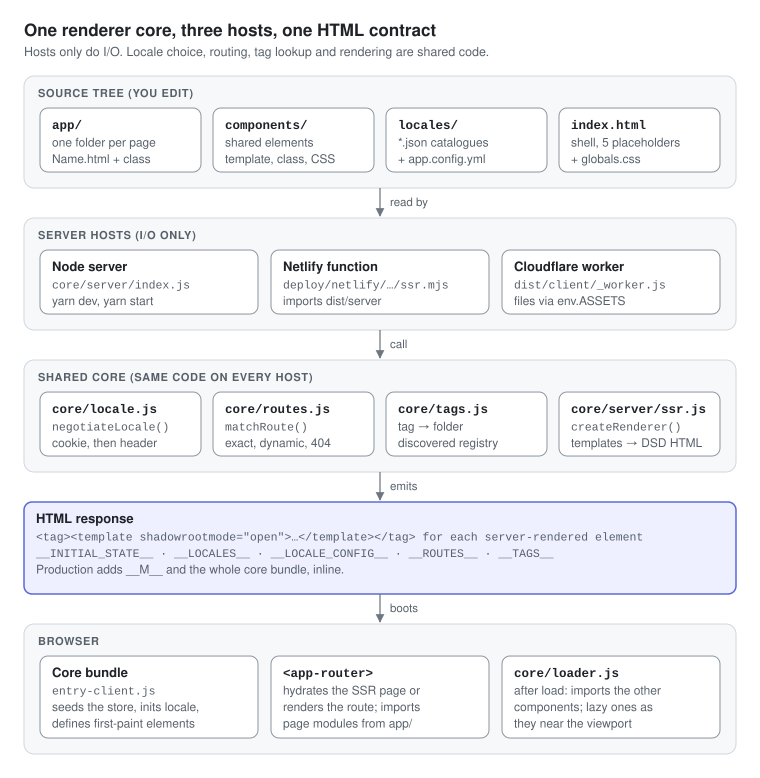

# Takeover developer guide

Takeover is a zero-dependency full-stack framework: server-rendered Web Components, file-system routing, a reactive store, i18n, live reload and a production bundler, all written against Node built-ins and browser APIs. `package.json` declares no dependencies, so `yarn dev` is just `node core/server/index.js`.

The repo holds two things:

- **The framework**: `core/` (rendering, routing, tag discovery, bundler, minifier, dev server) and `lib/` (the store instance, i18n, navigation, head metadata, validation and async helpers). `core/` names no project-specific tags, locales or routes; it reads them from `app.config.yml` or discovers them from the tree.
- **A site built with it**: `app/`, `components/`, `locales/`, `globals.css` and `public/`. It is the framework's own landing page, with one real route (`/`) plus the 404 page.

Five ideas explain almost every design choice:

1. **Pages and components are custom elements.** Markup lives in `Name/Name.html`, behaviour in a class extending `Component`, registered with `define('tag-name', Class)`.
2. **The server emits Declarative Shadow DOM.** Each element is rendered as `<tag><template shadowrootmode="open">…</template></tag>`, so the browser builds shadow roots before any script runs. Hydration binds events; it does not rebuild the DOM.
3. **The server never runs your classes.** It renders `.html` templates and reads page statics (`metadata`, `ssrProps`, `local`, `requiresAuth`) out of the source text with a regex and `eval`. Browser-only code at module level is safe.
4. **Re-rendering is wholesale.** A state change re-runs the template and reassigns `shadowRoot.innerHTML`. There is no virtual DOM; focus and text selection are saved and restored around the swap.
5. **Conventions are discovered, not configured.** Routes come from folders under `app/`, the tag-to-folder map from `define()` calls, and locales from `locales/*.json`.

This guide was checked against the code at commit `e35311b` (Oct 21, 2026) by reading every source file and running the dev server and the build on a scratch copy. Where behaviour differs from `README.md` (the older user manual) or `EXPLAINER.md` (internals notes), [Gotchas](11-gotchas.md) says so.

## Contents

| # | Page | Read it for |
| --- | --- | --- |
| 1 | [Architecture](01-architecture.md) | The parts, what runs where, and why the server never imports your classes |
| 2 | [Getting started](02-getting-started.md) | Commands, environment variables, and how the dev loop really behaves |
| 3 | [Project layout](03-project-layout.md) | Every folder, what to edit, and the naming rules the code relies on |
| 4 | [Request and boot lifecycle](04-lifecycle.md) | The server's nine steps and the browser's seven, placeholder by placeholder |
| 5 | [Components](05-components.md) | Statics, hooks, helpers, discovery, and how a component's JS arrives |
| 6 | [Templates and styling](06-templates-and-styling.md) | `{{ }}` syntax, the evaluator's limits, events, prop bindings, CSS Modules |
| 7 | [State and i18n](07-state-and-i18n.md) | The store, local state, and how a language is chosen and switched |
| 8 | [Routing and navigation](08-routing-and-navigation.md) | Folder-to-route rules, the Router element, navigation API, guards |
| 9 | [Build and deployment](09-build-and-deploy.md) | The ten build steps, the output trees, bundler, minifier, deploy targets |
| 10 | [Recipes](10-recipes.md) | Step-by-step changes: pages, components, routes, auth, locales, deploys |
| 11 | [Gotchas](11-gotchas.md) | Verified pitfalls, including a path-traversal hole in the Node server |
| 12 | [Reference](12-reference.md) | Config keys, window globals, exports, dev endpoints, numbers |

## Diagrams

| File | Shows |
| --- | --- |
| [`images/architecture.svg`](images/architecture.svg) | Sources, hosts, shared core, the HTML contract and the browser |
| [`images/lifecycle.svg`](images/lifecycle.svg) | One request on the server beside the boot sequence in the browser |
| [`images/component-lifecycle.svg`](images/component-lifecycle.svg) | `connectedCallback()` branches and the steps of `update()` |
| [`images/tag-registry.svg`](images/tag-registry.svg) | How `define()` calls become the tag registry and who reads it |
| [`images/build-pipeline.svg`](images/build-pipeline.svg) | `yarn build` from source to `dist/client`, `dist/server` and the hosts |

The diagrams are plain SVG with an embedded light and dark palette (`prefers-color-scheme`), so they follow the reader's theme on GitHub and in editors; edit them as text.

---

[Architecture →](01-architecture.md)
